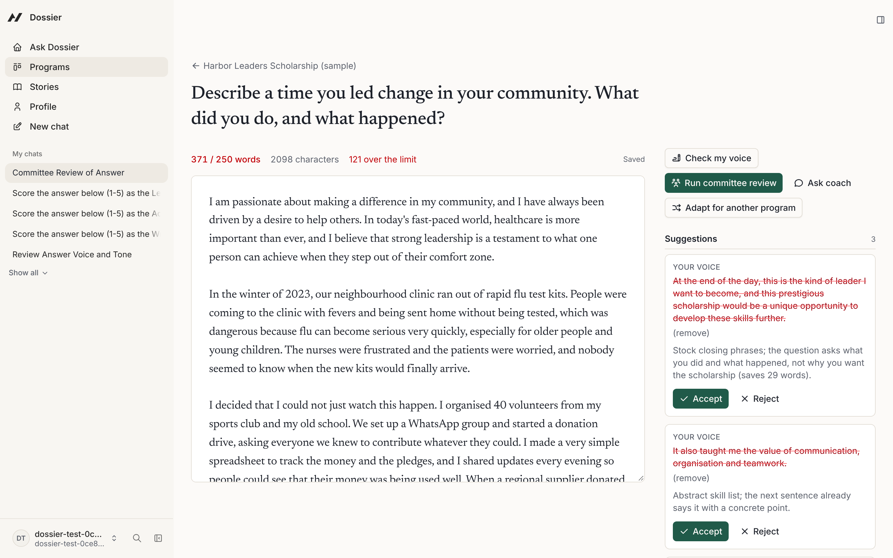
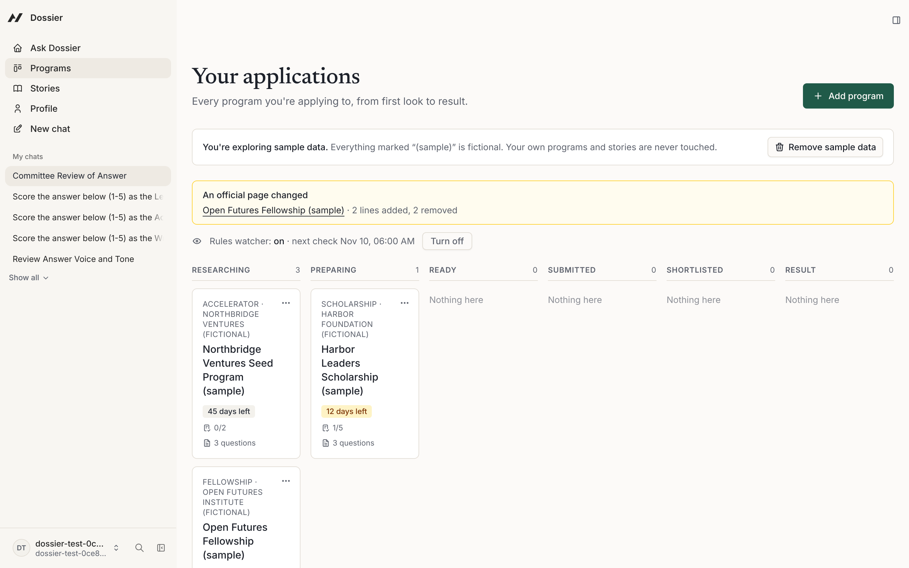
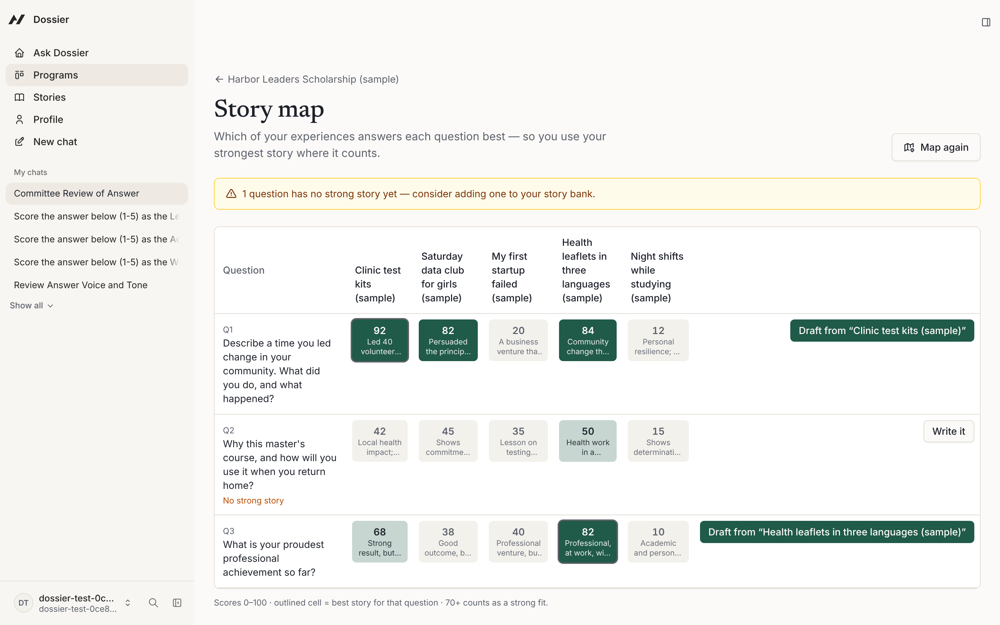
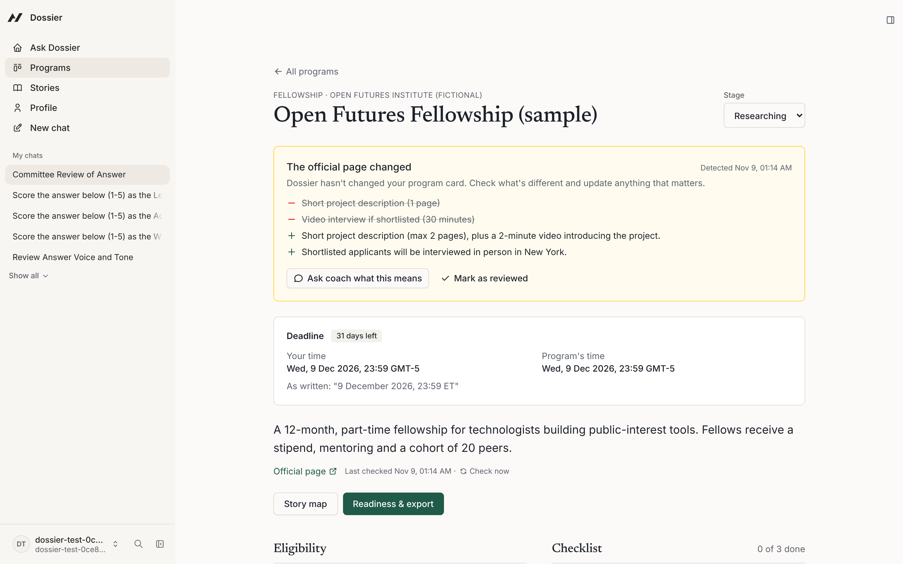
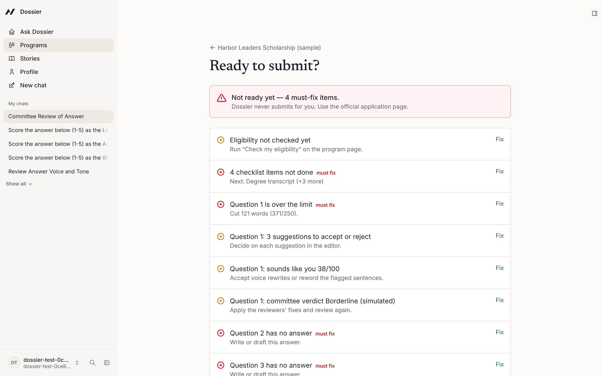
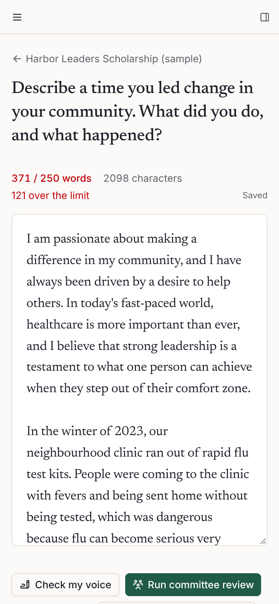
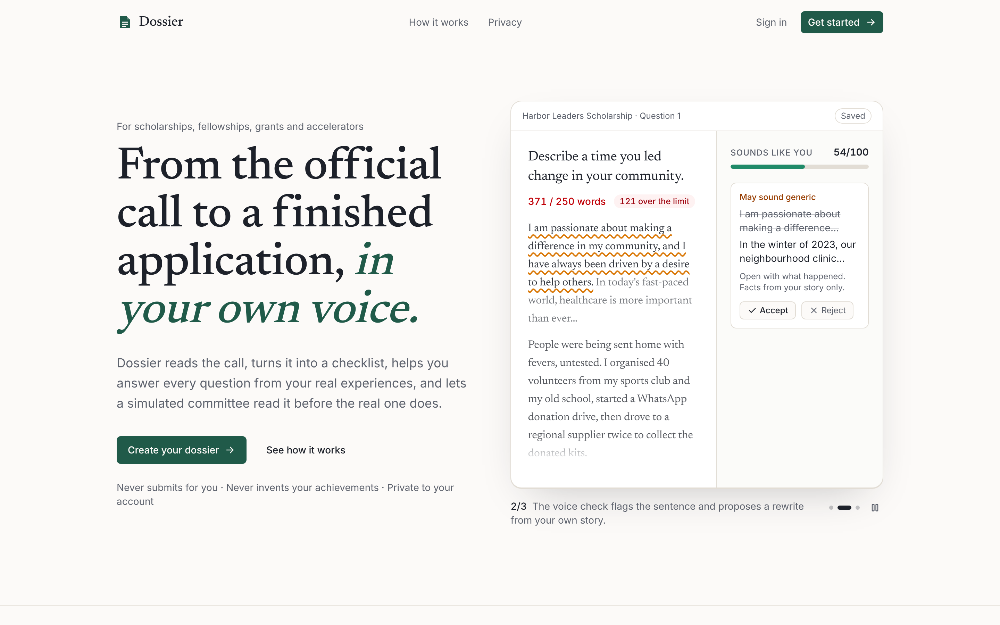

# Dossier

**Dossier helps applicants turn a scholarship, fellowship, grant or accelerator call into a finished application — in their own voice, reviewed by a simulated selection committee.**



- **Live app:** https://dossier-pied.vercel.app (sign up, then click **Try with sample data** on the board)
- **How it works / privacy:** [dossier-pied.vercel.app/how-it-works](https://dossier-pied.vercel.app/how-it-works) · [privacy & safety](https://dossier-pied.vercel.app/privacy)
- **Demo (Clips):** _add link_

Built with **[Agent-Native](https://www.agent-native.com/docs/)** for the **Builder.io Agent-Native Hackathon**.

---

## The problem

Applicants juggle several programs at once, each with its own eligibility rules, documents, word limits and deadlines. They rewrite the same stories again and again, miss requirements, and end up with generic AI-written answers that committees recognise and reject.

> _"Add a quote from a real tester here."_

## The solution

Paste a program's official link. Dossier turns its rules and questions into a checklist, shows which of **your** stories best answers each question, helps you draft, checks that the answer **sounds like you**, and has **three simulated reviewers** — built from the program's own criteria — score it before the real committee does. Reuse a finished answer for another program, get told when an official page changes, then check readiness and export one packet.

## Features

✅ = works in the submitted version and was tested on the live site (9 November 2026).

| Feature | What it does | Status |
|---|---|---|
| Add program from link | Rules, documents, questions, limits, deadline in both time zones, source; gaps marked "Not stated"; asks which program on list pages | ✅ |
| Eligibility & checklist | Rule-by-rule check against your profile (met / blocker / unknown + the question that settles it); every requirement as a task | ✅ |
| Story bank & story map | Your experiences × every question, fit scores 0–100, best story per question, uncovered questions | ✅ |
| Answer editor | Draft from a story, live word count, suggestions you accept or reject | ✅ |
| Sounds like you | Flags sentences that may sound generic against your own writing; rewrites from your own facts | ✅ |
| Committee panel | Three simulated reviewers (Agent Teams sub-agents) built from the program's criteria: score, best/weakest line, fix, verdict | ✅ |
| Readiness & export | ✅/❌ with fixes; one-file packet (Markdown, print / PDF) | ✅ |
| Agent chat | Knows which program, question and highlighted sentence you're on; every button is an action it can call | ✅ |
| Adapt an answer | Reuse a finished answer for another program's question and limit | ✅ |
| Rules watcher | Re-checks official pages every 3 days (automation) and when the board opens; shows lines added and removed | ✅ |
| Sample data | Three fictional programs, five stories, a draft 121 words over its limit | ✅ |
| Interview prep | Questions from your own application once shortlisted | Not built |
| Telegram companion | "What's due this week?" + reminders | Not built |
| References | Track referees; drafted request emails | Not built |

## Screenshots

| | |
|---|---|
|  |  |
| **Board** — every application by stage, deadlines, rules-watcher alerts | **Story map** — best story per question, and the question no story answers yet |
|  |  |
| **Rules watcher** — what changed on the official page | **Readiness** — what's left before you submit |
|  |  |
| **Phone** — the editor works at 390 px | **Public site** — landing, how it works, privacy |

## How it uses Agent-Native

| Agent-Native feature | In Dossier |
|---|---|
| `defineAction` | Every capability is one action (42 of them), shared by the screens, the chat and the automation |
| Action hooks | Screens call the same actions as the agent (`useActionQuery`, `useActionMutation`) |
| App-state + `view-screen` | The agent knows the program, question and highlighted sentence you're on |
| Agent Teams (custom sub-agents) | Each committee reviewer is its own agent profile (`agents/<slug>.md`), run in parallel |
| Automations | The rules watcher runs every 3 days per user (`jobs/dossier-rules-watcher.md`) |
| `sendToAgentChat` | Every AI button hands its task to the coach in a chat of its own |
| AGENTS.md | Golden rules and coaching workflows for the in-app agent |

## Tech stack

Agent-Native (`@agent-native/core` 0.226, chat template) · React Router · Drizzle ORM · PGlite (local) / Neon Postgres (production) · Claude via the Anthropic API · Vercel · Clips for the demo

A small framework patch lives in `patches/` (applied automatically by pnpm): on Neon, a null character in saved chat history made every follow-up chat message fail.

## Run it locally

Requires Node.js 22.22+ and pnpm.

```bash
git clone https://github.com/softalpha0/dossier.git
cd dossier
corepack enable
pnpm install
cp .env.example .env
pnpm dev
```

Open the local URL → **Continue as local dev** → **Programs** → **Try with sample data**.

`.env.example`:

```bash
ANTHROPIC_API_KEY=          # required for the coach, voice check and committee
DATABASE_URL=               # production only (Neon pooled); local dev uses PGlite
DATABASE_URL_UNPOOLED=      # production only (Neon direct), for migrations
BETTER_AUTH_SECRET=         # production only: openssl rand -hex 32
A2A_SECRET=                 # production only: signs background handoffs; without it reviewers never start
APP_URL=                    # production only: e.g. https://dossier-pied.vercel.app
CRON_SECRET=                # production only (Vercel cron)
```

## Principles

- Your words stay yours — agent edits are suggestions until you accept them.
- No invented facts — missing details are asked for or marked "Not stated".
- Dossier never submits applications or emails anyone.
- The committee is simulated; the voice check says "may sound generic", never "AI detected".

## Team

[softalpha0](https://github.com/softalpha0) — solo builder

## Contributors

- [softalpha0](https://github.com/softalpha0) — product, design decisions, testing, deployment
- **Claude (Anthropic)** — AI pair programmer via Claude Code: wrote code under softalpha0's direction. All commits and pushes are made by softalpha0.

## What's next

A Telegram companion ("what's due this week?") · interview practice from your own answers once shortlisted · a referee tracker with drafted requests · mentor and counsellor views · multi-language support.

## License

[MIT](./LICENSE)
